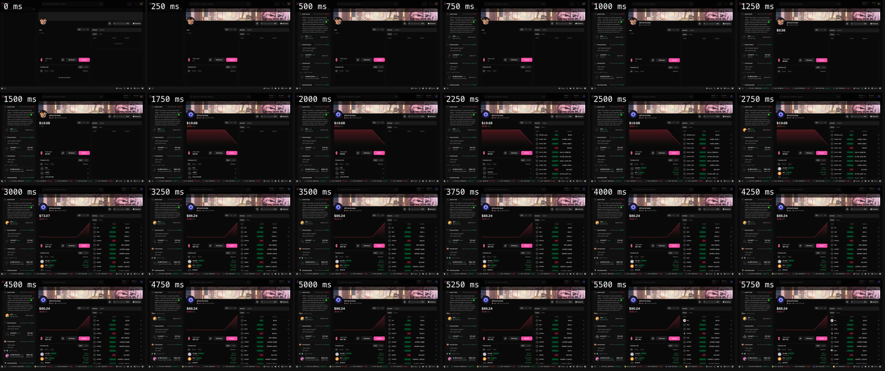

# Case study: Suzi, a trading web app

This harness and its rules come from [Suzi](https://suzi.trade), an AI trading app: a Next.js / React monorepo with
a live chart, a market feed, an order panel, a sign-in SDK and a chat dock. All of it is heavy, and all of it is
live. The goal we set was blunt: **the first view appears as the URL is entered.** The frame should land in under
500 ms, the user's own data in under 1 s on a warm visit, and **nothing a user waits for may take longer than 6 s
on a mid-range phone on a first visit**.

All numbers below were measured with this harness's predecessor against local production builds. They are medians
of 2–3 runs unless noted. "Mobile" is 4× CPU with Fast 4G.

## What a measured load looks like

The portfolio page, signed in, desktop cold, 11 Oct 2026.

The real layout is on screen in the first tile, with no skeletons or spinners. Data fills in place: the portfolio
value appears at 1.25 s and settles at 3.25 s as positions are priced, well inside the 6 s ceiling. Medians of three
runs: FCP 68 ms, header balance 1,155 ms.

## The budgets

| Metric | Desktop warm | Desktop cold | Mobile cold |
| --- | ---: | ---: | ---: |
| First paint (FCP) | < 150 ms | < 300 ms | < 1 s |
| Header balances | < 300 ms | API-bound | API-bound |
| Trade panel / chart frame on a market URL | < 300 ms | < 1 s | < 2 s |
| Chart candles on a market URL | < 500 ms | < 2 s | < 4 s |
| `/` first-load JS (gzip) | — | ≤ 630 KB | — |
| **Ceiling: any mark** | **6 s** | **6 s** | **6 s** |

The marks were `shell`, `header` (a `$` figure in the header), `feed`, `tradePanel` (a visible Buy button),
`chartFrame` (the chart iframe), `chartCandles` (chart canvases drawn and the loader gone), `positions`,
`portfolioValue` and `agents`.

## Why a 6 s ceiling

On 11 Oct 2026 the slowest mark, chart candles on a cold phone load, sat right at the edge or over it:

| Route | Mobile cold, chart candles |
| --- | ---: |
| Home | 5,990 ms |
| A market page | **7,243 ms** ❌ |

Two days later, after the mobile work (phone-only pieces split out of the desktop bundle, the open market's panels
fetched as the workspace mounts), both were under it:

| Route | Mobile cold, chart candles |
| --- | ---: |
| Home | 5,484 ms |
| A market page | 5,592 ms |

Per-mark budgets tell you where you want to be. The ceiling tells you the worst a first-time phone user may wait,
and it fails on any single run.

## What moved the numbers

Each line is a rule in [`references/rules.md`](skills/frontend-perf/references/rules.md) now.

| Change | Before | After |
| --- | ---: | ---: |
| Removed entrance animations hiding server HTML (41 elements at `opacity: 0`): login page paint on a phone | 2.1 s | 0.63 s |
| Moved the sign-in/wallet SDK behind a facade, loaded after hydration | +~650 KB gzip on first load | 0 on the critical path |
| Booted the chart hidden on a stand-in symbol while the feed picks a market: candles after load | ~2.2 s | ~0.4 s |
| Prefetched header search on idle, under the exact query key: rows after the click | 1.0–2.5 s | ~70 ms |
| Batched per-row price requests into one endpoint: requests in 15 s | 75 | 9 |
| Removed a service worker fetch handler that didn't cache anything | ~250 ms of every warm first paint | 0 |
| Routed images through an optimizer at ~2× drawn size (one 36 px avatar was a 1.6 MB PNG): cold home page weight | 13.8 MB | 9.5 MB |
| Same, portfolio page | 12.1 MB | 7.3 MB |
| Virtualized discovery rows: DOM descendants in the rail | 2,936 | 609 |
| Dropped digit-column animations in dense market rows: descendants for 26 rows | 3,776 | 468 |
| Header Portfolio button prefetched on idle and intent: route paint after the click | 4,291 ms (first visit) | 168 ms (next visit) |

## The counter-example: when the budget had to go up

The order panel was split out and loaded on demand. That's what rule 5 says to do. On a cold phone load, its chunk
was requested only after the main JS ran, then queued behind the chart library and the token list. It drew at
**17–25 s**. Imported statically (+35 KB gzip), it drew at **~7.6 s**. A fresh home page nearly always opens a
market, so the panel now ships with the page and the first-load JS budget went from 600 KB to 630 KB. The lesson
is to measure what the page waits on, not only bytes.

## The phantom regression

Two sequential batches of the same two builds, 20 minutes apart, showed a 300–500 ms "header regression". Measured
**interleaved** (one cold load of each in turn), it was zero. The API's latency had drifted during the window.
That's why `ab.mjs` exists, and why it's the only way the skill compares builds.

The same audit found what *had* regressed: weight, not timing. Images were bypassing the optimizer and a list
virtualizer was riding a barrel import into the home page. Fixing both brought cold home from 13.8 MB to 9.5 MB and
first-load JS from 594 KB to 586 KB.

## Last measured tables

11 Oct 2026, ms, signed in, local production build:

| Route | Profile | Mode | FCP | header | tradePanel | chartCandles |
| --- | --- | --- | ---: | ---: | ---: | ---: |
| Home | desktop | warm | 60 | 102 | 636 | 736 |
| Home | desktop | cold | 68 | 897 | 910 | 2215 |
| Market | desktop | warm | 48 | 118 | 45 | 257 |
| Market | desktop | cold | 76 | 959 | 70 | 1958 |
| Home | mobile | warm | 156 | 347 | 750 | 1218 |
| Home | mobile | cold | 508 | 3773 | 807 | 5990 |
| Market | mobile | cold | 516 | 3107 | 521 | 7243 |

13 Oct 2026, after the mobile work:

| Route | Profile | Mode | FCP | header | tradePanel | chartCandles |
| --- | --- | --- | ---: | ---: | ---: | ---: |
| Home | desktop | warm | 32 | 115 | 411 | 220 |
| Market | desktop | warm | 56 | 159 | 52 | 282 |
| Market | desktop | cold | 72 | 1473 | 74 | 433 |
| Home | mobile | cold | 496 | 2781 | — | 5484 |
| Market | mobile | cold | 508 | 2431 | 1824 | 5592 |

Cold header times wait on the API: a first visit has nothing cached. Warm visits paint from the persisted query
cache instead. The harness makes that split visible. It's the gap between the `header` mark on cold and on warm.
