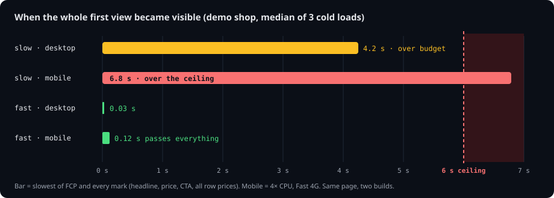
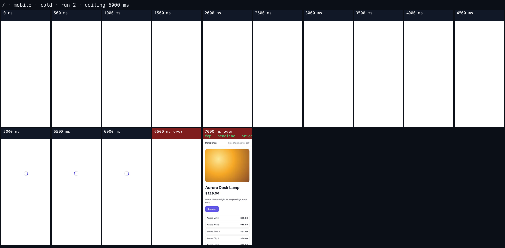
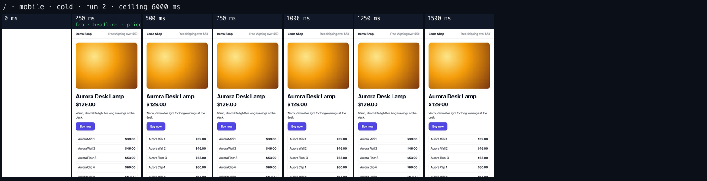
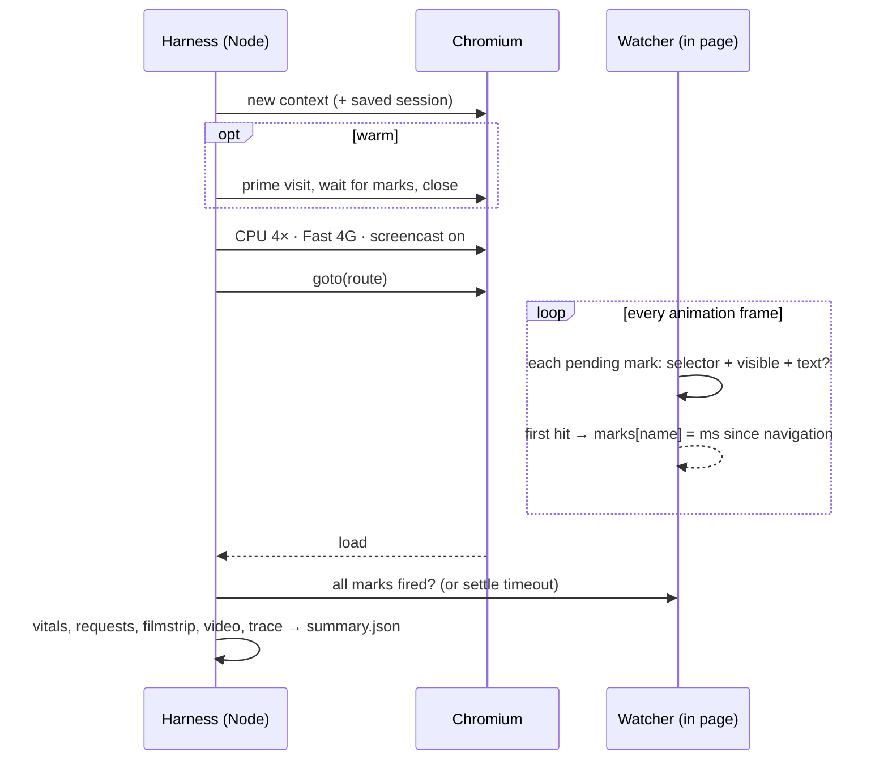
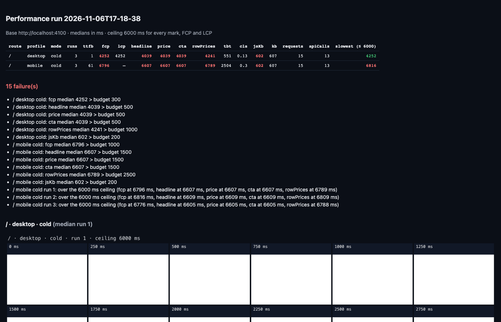

# frontend-perf: an agent skill for end-to-end page-load testing

Works with **Claude Code, Codex, Cursor, Gemini CLI, GitHub Copilot** and any coding agent that can run a shell. It's
a standard [Agent Skill](https://agentskills.io) (a `SKILL.md` with plain-Markdown references) plus a plain Node +
Playwright harness. Nothing in it depends on one vendor.

**Hand your AI agent the whole performance test.** It installs a filmstrip harness in your repo, builds and serves
your app in production mode, works out what "loaded" means on each page, measures desktop and throttled mobile,
reads the filmstrips, finds the cause, and proves a fix with interleaved A/B runs. Your only manual step is signing in.

One promise sits underneath it all: **on a mid-range phone, a first-time visitor sees every part of the first view
within 6 seconds.** Any run that misses it fails.

Built and proven on [Suzi](https://suzi.trade), an AI trading app, where it took a phone's chart load from 7.2 s to
under the ceiling. The numbers are in the [case study](CASE-STUDY.md).



<table>
<tr><td><b>Slow build, mobile cold</b>: white for 5 s, a spinner, content at 6.6 s. Red tiles are past the ceiling.</td></tr>
<tr><td></td></tr>
<tr><td><b>Fast build, same page</b>: every mark at ~83 ms, so it's all there in the first tile.</td></tr>
<tr><td></td></tr>
</table>

---

## Contents

- [What you get](#what-you-get)
- [How it works](#how-it-works)
- [Install](#install)
- [Try it in two minutes (demo app)](#try-it-in-two-minutes)
- [Use it on your app: the end-to-end guide](#use-it-on-your-app-the-end-to-end-guide)
- [Reading the results](#reading-the-results)
- [Access: what to give the agent](#access-what-to-give-the-agent)
- [Dependencies](#dependencies)
- [CI](#ci)
- [Limits](#limits)
- [Case study: Suzi](CASE-STUDY.md) ([suzi.trade](https://suzi.trade))

## What you get

| | |
| --- | --- |
| **Marks** | You name the pieces of the first view the user waits for (`headline`, `price`, `cta`, `chart`), as selectors plus optional text, e.g. "a `$` and a digit". The harness records the first frame each one is *visible*: rendered, not `opacity: 0`, and on screen. |
| **Filmstrips** | One tile every 250 ms, labelled with the marks that fired since the previous tile. Tiles past the ceiling are red. Plus a video, a Playwright trace and a final screenshot for every run. |
| **Profiles** | `desktop` (as is) and `mobile` (4× CPU, Fast 4G, 390 × 844, touch), each **cold** (first visit) and **warm** (returning visitor with primed caches). |
| **Budgets + 6 s ceiling** | Per-mark budgets on medians, plus a hard ceiling that every run must meet. Missing a mark counts as a failure. Exit code 1 on failure. |
| **Interleaved A/B** | Two builds on two ports, alternating A,B,B,A… so backend and machine drift hit both sides. A difference counts as "clear" only when the runs don't overlap. |
| **Diagnosis tools** | `probe` (why a mark never fires), `waterfall` (what finished just before a late mark), `requests` (request storms), `initiators` (which code fired a request). |
| **The playbook** | `SKILL.md` and its references tell the agent the order of work, the non-negotiables (production builds, headless, don't touch your dev server, never handle credentials), the symptom → cause → fix table, and how to report. |

## How it works

```mermaid
flowchart LR
  A[Scope<br/>routes, marks,<br/>sign-in, budgets] --> B[Install harness<br/>tools/perf]
  B --> C[Build + serve<br/>production :3100]
  C --> D{{doctor}}
  D -->|needs sign-in| L[/You log in once<br/>in a real browser/]
  L --> P
  D --> P[probe<br/>every mark fires?]
  P --> M[measure<br/>desktop+mobile<br/>cold+warm × 3]
  M --> R[report<br/>medians, budgets,<br/>6 s ceiling, filmstrips]
  R --> X[diagnose<br/>waterfall · requests<br/>initiators · trace]
  X --> F[fix one thing<br/>if asked]
  F --> AB[interleaved A/B<br/>base :3200 vs head :3100]
  AB --> OUT[numbers + filmstrips<br/>in the PR]
```



**One measured load.** A fresh browser context (cold), or a context primed by one full visit (warm). The page is
throttled through the Chrome DevTools Protocol, recorded with a screencast, and watched every animation frame by a
small script injected before the app's own code:



**Why interleaved A/B.** Backend latency drifts by hundreds of ms over minutes. Two batches measured 20 minutes
apart once showed a 300–500 ms "regression" that disappeared when the same builds were interleaved:

```
backend latency  ▁▁▁▁▁▁▁▁▃▃▅▅▅▅▅▅▅▅▅▅   (drifts upward during the session)

sequential       A A A A A B B B B B    B lands on the slow half: a fake regression
interleaved      A B B A A B B A A B    both sides see the same drift: the gap is the build
```

## Install

The skill is the folder [`skills/frontend-perf`](skills/frontend-perf): `SKILL.md`, its `references/` and the
`harness/`. Put that folder wherever your agent looks for skills.

| Agent | Install |
| --- | --- |
| **Claude Code** | `/plugin marketplace add scriptscrypt/frontend-performance-testing-skill`, then `/plugin install frontend-perf@frontend-performance-testing-skill`. Or copy the folder to `~/.claude/skills/` (all projects) or `<repo>/.claude/skills/` (one repo). |
| **Codex** | Copy the folder to `~/.codex/skills/`. |
| **Cursor, Gemini CLI, Copilot and others** | `npx skills add scriptscrypt/frontend-performance-testing-skill`, which asks which agents to install it for. Or copy the folder to the skills directory your agent documents. |
| **Any agent without skill support** | Clone the repo and tell the agent: *"Read `skills/frontend-perf/SKILL.md` and follow it."* To make that permanent in a project, add the same line to its `AGENTS.md`. |

```bash
git clone https://github.com/scriptscrypt/frontend-performance-testing-skill
cp -R frontend-performance-testing-skill/skills/frontend-perf ~/.codex/skills/    # or ~/.claude/skills/, etc.
```

Then just ask: *"Measure the load performance of /pricing and /dashboard"*, *"Why does the chart show up late on
mobile?"*, *"Did this branch make the home page slower?"*. The skill loads when the request matches.

## Try it in two minutes

The repo ships a tiny product page in two builds: a **slow** one that does what slow apps do (a render-blocking
600 KB script, a spinner, fetching data only after the JS runs, a long main-thread task, a fade-in, one request
per price row) and a **fast** one that server-renders the same page.

```bash
cd frontend-performance-testing-skill
node examples/demo-shop/server.mjs --variant slow --port 4100 &
node examples/demo-shop/server.mjs --variant fast --port 4200 &

cd skills/frontend-perf/harness
npm run setup                                         # playwright + sharp + Chromium, once

node doctor.mjs  --config ../../../examples/demo-shop/perf.config.json
node probe.mjs / --config ../../../examples/demo-shop/perf.config.json --profile mobile
node measure.mjs --config ../../../examples/demo-shop/perf.config.json            # slow build: fails
node measure.mjs --config ../../../examples/demo-shop/perf.config.json --base http://localhost:4200   # fast: passes
node ab.mjs      --config ../../../examples/demo-shop/perf.config.json --a http://localhost:4100 --b http://localhost:4200 --labels slow,fast --runs 3
```

Open the `report.html` it prints. Add `--headed` to any command to watch the browser (not for quoting numbers).

What you should see (MacBook, 3 runs each):

| Build | Profile | FCP | headline | all row prices | JS before load | Ceiling |
| --- | --- | ---: | ---: | ---: | ---: | --- |
| slow | desktop cold | 4252 | 4039 | 4241 | 602 KB | ✅ 4.3 s (but every budget fails) |
| slow | mobile cold | 6796 | 6607 | 6789 | 602 KB | ❌ 6.8 s |
| fast | desktop cold | 28 | 11 | 11 | 0 KB | ✅ |
| fast | mobile cold | 116 | 83 | 83 | 0 KB | ✅ |

`probe` also shows why marks need checking. On mobile, only 5 of the 12 price rows are on screen, so a "12 visible
prices" mark can never fire, and `probe` says exactly that. The demo config marks it `"visible": false` (count rows
in the DOM).



## Use it on your app: the end-to-end guide

What the agent does, and the one step you do. The agent follows [`SKILL.md`](skills/frontend-perf/SKILL.md). This
is the same flow for a human reader.

**1. Scope.** The agent reads the repo and then asks you once: which routes, what the first view is on each (2–5
things a user waits for), whether sign-in is needed, how to build and start, budgets (6 s ceiling by default), and
whether it may change code or only measure.

**2. Install the harness** into `tools/perf/` (standalone, not a workspace package) and download Chromium:

```bash
cp -R <skill folder>/harness tools/perf   # e.g. ~/.codex/skills/frontend-perf/harness
cp tools/perf/perf.config.example.json tools/perf/perf.config.json
npm --prefix tools/perf run setup
```

**3. Build and serve production** on a free port, never on top of your running dev server
([commands per framework](skills/frontend-perf/references/frameworks.md)), and check:

```bash
npm --prefix tools/perf run doctor
```

```
  ✓  Node 24.20.0
  ✓  Playwright + Chromium installed
  ✓  sharp installed (filmstrips)
  ✓  4 mark(s): headline, price, cta, rowPrices
  ✓  Routes / · profiles desktop, mobile · ceiling 6000 ms
  ✗  http://localhost:4100 not reachable (ECONNREFUSED). Start the production server first.
```

It also fails if the server looks like a dev server (Vite, webpack or Next.js dev markers in the HTML).

**4. Sign in (you).** If routes need a session, the agent asks you to run this in your own terminal (in Claude
Code you can type it in the session with a `!` prefix):

```
npm --prefix tools/perf run login
```

A real browser opens and you log in. The session is saved to `tools/perf/.auth/state.json`, which is gitignored and a
live credential, so keep it to yourself. The agent never sees your password.

**5. Define marks and probe them.** In `perf.config.json`:

```json
"marks": {
  "balance": { "selector": "header", "text": "\\$\\s?[0-9]" },
  "cta":     { "selector": "button", "text": "^(buy|long)\\b" },
  "chart":   { "selector": "iframe[id^=tradingview]", "onRoutes": ["^/trade"] }
}
```

Real output from the demo, before its config was fixed:

```
$ node probe.mjs / --profile mobile
/ → http://localhost:4200/ (HTTP 200)  fcp=116
  ✓  headline         81 ms
  ✓  price            81 ms
  ✓  cta              81 ms
  ✗  rowPrices        never fired — 5 visible match(es) but text /\$[0-9]/ never matched; saw ["$39.00","$46.00","$53.00"]
```

(Twelve rows wanted, five on a phone screen. The fix is in the mark, `"visible": false`, not in the app.)

The agent fixes the definition until every mark fires on every route and profile. [Mark reference](skills/frontend-perf/references/config.md#marks).

**6. Baseline.** `npm --prefix tools/perf run measure` runs every route × profile × mode × 3 runs and prints a
median table with ❌ on failed budgets and a pass/fail for the ceiling. The agent then **opens the filmstrips and
looks at them**. It can read images, so it describes what a user actually saw.

**7. Diagnose** from the slowest mark backwards with `waterfall`, `requests`, `initiators` and the trace
([symptom → cause → fix](skills/frontend-perf/references/diagnosis.md)).

**8. Fix one thing** (only if you asked), guided by [the rules](skills/frontend-perf/references/rules.md).

**9. Prove it.** The baseline is built in a git worktree and served on :3200, then compared interleaved:

```bash
npm --prefix tools/perf run ab -- --a http://localhost:3200 --b http://localhost:3100 --labels base,head --route /trade --profile mobile --runs 5
```

The demo's A/B (slow vs fast build, mobile cold, 3 runs each, interleaved):

| metric | slow | fast | Δ | Δ% | verdict | slow runs | fast runs |
| --- | ---: | ---: | ---: | ---: | --- | --- | --- |
| fcp | 6796 | 116 | -6680 | -98% | clear: fast better | 6796, 6796, 6780 | 116, 116, 116 |
| headline | 6607 | 82 | -6525 | -99% | clear: fast better | 6607, 6590, 6607 | 82, 82, 81 |
| rowPrices | 6790 | 82 | -6708 | -99% | clear: fast better | 6789, 6791, 6790 | 82, 82, 81 |
| tbt | 2497 | 0 | -2497 | -100% | clear: fast better | 2497, 2498, 2495 | 0, 0, 0 |
| requests | 15 | 2 | -13 | -87% | clear: fast better | 15, 15, 15 | 2, 2, 2 |

Real changes are rarely this clean. Expect `within noise` on most rows and a `clear` only where you changed something.

**10. Report.** The agent gives you the commands, build refs, median tables, the A/B verdicts, one or two filmstrips,
the cause and fix with evidence, and the caveats. Then it adds the dated numbers to your performance doc if you
keep one.

## Reading the results

```
tools/perf/runs/2026-11-06T17-18-38/
├── report.html / report.md          medians, budgets, ceiling, the median run's filmstrip per group
├── results.json                      every run
└── home__mobile__cold__1/
    ├── summary.json                  ttfb fcp lcp cls tbt marks ceiling jsKb kb requests longTasks apiUrls …
    ├── filmstrip.png                 what the user saw, every 250 ms
    ├── video.webm                    the load, for people
    ├── trace.zip                     npx playwright show-trace trace.zip
    └── final.png                     did it really load? (not a login wall)
```

- **Marks beat vitals.** FCP can be a spinner, and LCP can be skipped or point at a banner. Marks are what *you*
  defined as the page being ready.
- **Filmstrip patterns**: long white means render-blocking code or an empty HTML shell. A spinner means data fetched
  after JS. Values filling one by one means a request per row. DOM ready but a blank tile means a fade-in.
  Desktop-fast, mobile-slow means CPU-bound.
- **A/B verdicts**: `clear` means no overlap between sides. `within noise` means you can't claim it.

Full field list: [methodology.md](skills/frontend-perf/references/methodology.md#outputs).

## Access: what to give the agent

| Level | The agent can | Needs |
| --- | --- | --- |
| 0 · Read results | Explain existing runs and filmstrips | Read files |
| 1 · Measure | Install, build, serve on a free port, run every tool | Shell for build/serve and `npm --prefix tools/perf run …`, write to `tools/perf/` |
| 2 · Fix | Change code, rebuild, re-measure | Edit files |
| 3 · Compare builds | Baseline in a git worktree, interleaved A/B | `git worktree`, a second port |

It never needs your passwords (you sign in yourself), push rights, or production access. Whatever your agent's
approval settings look like, allow the commands above and deny reads of `tools/perf/.auth/`. A ready-made Claude Code
template is in [access.md](skills/frontend-perf/references/access.md), with notes for other agents.

## Dependencies

| | |
| --- | --- |
| Node.js | 18 or newer |
| [Playwright](https://playwright.dev) | `^1.64`, Chromium only (throttling and screencast use the Chrome DevTools Protocol) |
| [sharp](https://sharp.pixelplumbing.com) | `^0.34` for filmstrips. With npm 11 you may see an "install-scripts" warning for sharp. The prebuilt binaries still install, and `doctor` confirms it. |
| Disk / network | ~150 MB for Chromium, once. After that the harness talks only to the servers in your config. |
| Your app | Anything that serves HTML to Chromium: Next.js, Vite, Remix, SvelteKit, Nuxt, Astro, Angular, static. |

`npm --prefix tools/perf run setup` installs all of it.

## CI

`measure` exits 1 when a budget or the ceiling fails:

```yaml
- run: npm ci && npm run build && (npm start -- -p 3100 &) && npx wait-on http://localhost:3100
- run: npm --prefix tools/perf run setup
- run: npm --prefix tools/perf run measure -- --modes cold --runs 3 --no-video --no-trace
- uses: actions/upload-artifact@v4
  if: always()
  with: { name: perf, path: tools/perf/runs }
```

CI runners are noisy. Gate on the ceiling and generous budgets, and use interleaved A/B on a quiet machine for fine
comparisons.

## Limits

- **Lab, not field.** Localhost has no network distance to your server, and real devices vary. Use this to rank
  changes and catch regressions. Use real-user monitoring for what users get.
- **Chromium only.** Safari and Firefox aren't measured.
- **Live pages** (tickers, carousels) never stop changing, so `speedIndex`/`visuallyComplete` overstate. Trust marks.
- **Cross-origin iframes** can't be looked inside. Mark the iframe element instead.
- **LCP** isn't always reported by Chromium (e.g. content that fades in). The ceiling then relies on marks and FCP.

## Repo layout

```
frontend-performance-testing-skill/
├── .claude-plugin/              Claude Code plugin + marketplace manifests (other agents ignore it)
├── skills/frontend-perf/
│   ├── SKILL.md                 the agent's playbook
│   ├── references/              config · methodology · diagnosis · rules · frameworks · access
│   └── harness/                 copied into your repo as tools/perf
│       ├── lib.mjs              config, profiles, in-page watcher, one measured load, filmstrip
│       ├── doctor.mjs  login.mjs  probe.mjs  measure.mjs  report.mjs  ab.mjs
│       └── waterfall.mjs  requests.mjs  initiators.mjs
├── examples/demo-shop/          slow + fast builds of one page, and its config
├── docs/images/                 the pictures in this README (real runs of the demo)
├── CASE-STUDY.md                the production app this came from, with its numbers
└── AGENTS.md                    points any agent opened in this repo at the skill
```

## License

[MIT](LICENSE)
